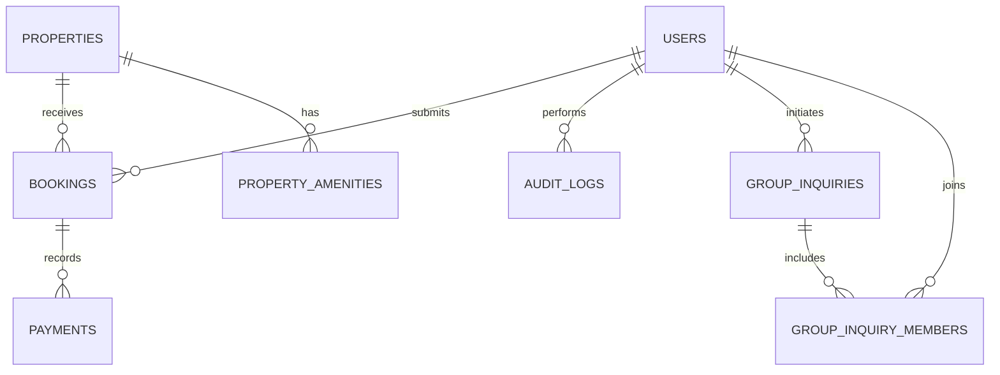

# SettleIn database

The Software Engineering app uses `settlein_se_db`. The previous project's `settlein_db` is a source for the one-time copy only. The backend rejects configuration targeting another database.

## Core cardinalities

The full column definitions and SQL types are in [`schema.sql`](../server/database/schema.sql). `property_amenities` and `group_inquiry_members` hold repeated values as one row per relationship instead of comma-separated lists.

| Table | Purpose | Relationships |
| --- | --- | --- |
| users | Accounts, hashed passwords, profile information and student/landlord/admin roles | One user submits many bookings; referenced by audit_logs |
| properties | Accommodation details, price, image, verification and available units | One property receives many bookings and has many amenities through `property_amenities` |
| property_amenities | One amenity value per property | property_id references properties; composite primary key prevents duplicate amenities |
| bookings | Student requests, move-in dates, lease dates and reservation status | user_id references users; property_id references properties |
| payments | Recorded payment amount, reference and status | booking_id references bookings |
| audit_logs | Administrator action, actor, target and timestamp | actor_id identifies the administrator; target_id identifies the affected record |
| group_inquiries | Existing shared-housing inquiries retained from the source | initiator_user_id references users; one inquiry has many group_inquiry_members |
| group_inquiry_members | One member account per inquiry | inquiry_id references group_inquiries; user_id references users; composite primary key |

The schema separates property amenities and group-inquiry membership into junction tables. Fresh schemas enforce booking-to-user/property, audit-to-user, payment-to-booking, amenity-to-property, and inquiry/member relationships with foreign keys. Run `npm run db:normalize` after copying an existing database; it migrates the old comma/JSON lists, verifies referenced accounts, and refuses to continue when orphan records need reconciliation. The copy itself preserves source rows and does not silently discard legacy data. `property_title` in a booking is retained as a historical title snapshot.

New reservations start as `pending`. Administrators may approve, reject or cancel them. Approval atomically consumes one vacant unit. Cancellation of an approved reservation restores that unit. Existing `active` bookings remain valid legacy records; cancelling one leaves vacancy unchanged because the previous system did not decrement inventory. Administrators can reconcile legacy inventory through listing edits. Listings with reservation history cannot be deleted; unpublish them instead.

New listings are unpublished until verified. Public users cannot register as administrators. Password changes use salted scrypt hashes and invalidate existing sessions. Audit logs record listing updates/deletions, reservation decisions, role changes and password resets.

The payment table does not imply that M-PESA or another payment gateway is connected. It remains empty until genuine payment records are supplied.
